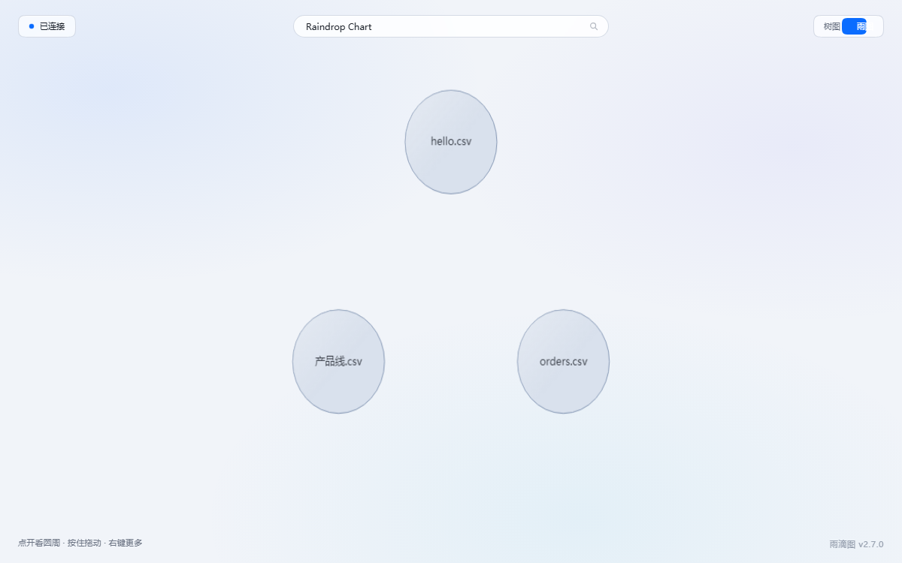
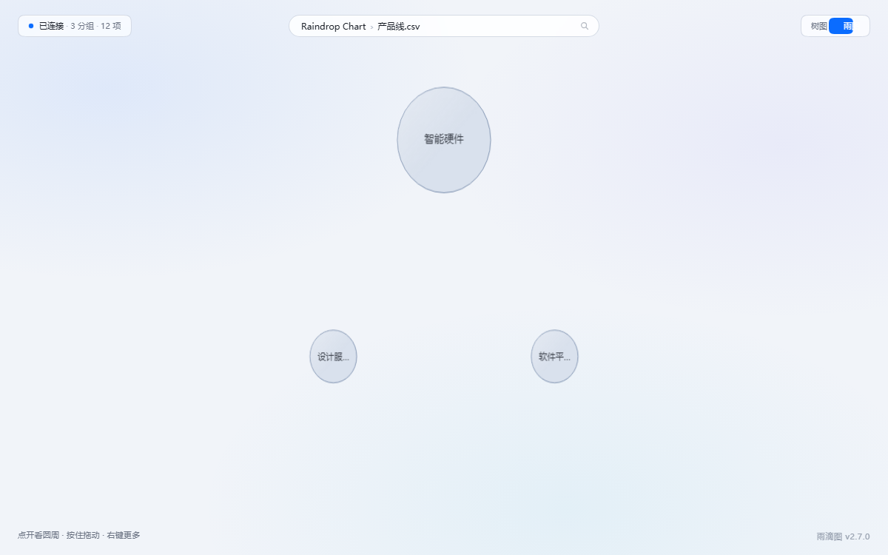
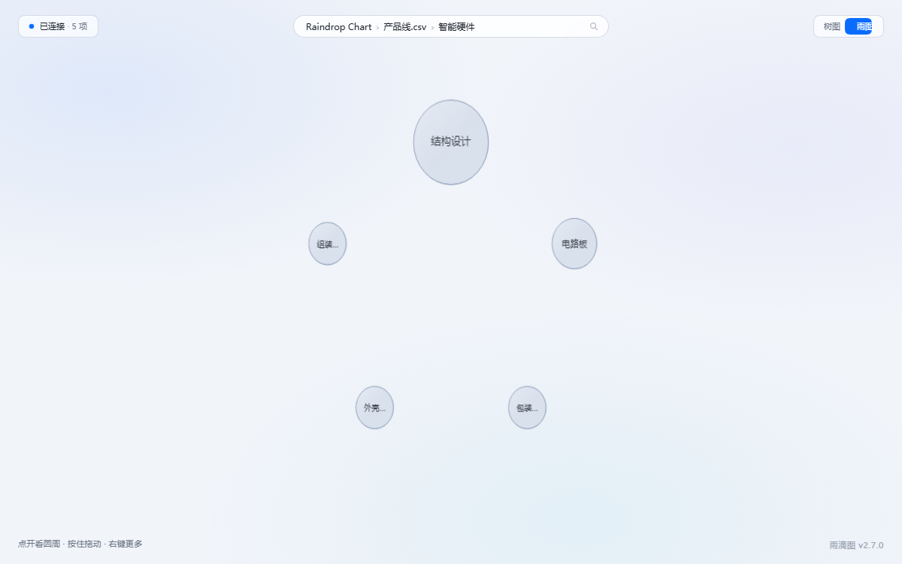

# Raindrop Chart

**Draw your scattered files as one diagram you can click through.**



---

## The situation you're in

Three months of project files, forty conversations, a proposal you rewrote twice —
all of it sits on your disk, and nobody can answer at a glance:

- Which part of this is actually heavy?
- Which files have I edited over and over?
- What have I been doing twice?

Raindrop Chart turns that pile into **one diagram**: the size of a circle is its weight,
one click takes you a level deeper, another click takes you to the individual steps.
No network, no upload, no account. It runs on your own machine.

---

## Three things it does

### ① Files become raindrops

Any set of files, any folder tree, any data — one diagram, clickable all the way down.
Big circles are heavy things, small circles are light ones. You drill in layer by layer
instead of digging through folders.



Drop in a CSV and it shows up. If you use Buddy, its conversation history reads in directly.



### ② Install one skill and Buddy understands your sessions

Two clicks, and Buddy can read that same structure.

> "Where did I spend the most time last week?"
> "Which files did I edit more than three times?"

No more pasting context into a chat box — it goes and looks it up itself.

**It only reads.** It won't edit your files, send messages, or touch your accounts.

### ③ Lock the few things you don't want AI to read

Even with permissions wide open, you can mark specific items as off-limits to Buddy.

A lock hides nothing from you: you open them as usual, they stay right where they are.
They just don't enter Buddy's field of view. The password is never stored in plain text —
only a salt and a check value sit on disk.

---

## Three steps

### Step 1 · Start it

**Windows**: double-click `双击启动雨滴图.vbs`. Your browser opens by itself. No console
window, nothing to configure.

The first double-click **puts a `Raindrop Chart` icon on your desktop** — after that, start it
from there. (The browser tab uses the same icon once the server is up.) Delete it and it **won't come back**; move the folder and the next launch re-points it.

**macOS / Linux**: in this folder, run

```bash
chmod +x start.sh && ./start.sh
```

**One prerequisite**: Python 3.8+ on the machine. If it's missing, install it first
([python.org](https://www.python.org/downloads/); on Windows tick `Add python.exe to PATH`
on the first screen).

### Step 2 · Give it something to draw

| What you want to see | What to do |
|---|---|
| Your own CSVs / folders | Drop them in `data/sources/`, refresh the page |
| Your own conversation history | Already there if you use Buddy |
| Just a look around | Nothing — a sample comes with it |

The first time you open it, it's empty (a sample, nothing else). That's expected.

### Step 3 · Let Buddy read it too — one more double-click

Double-click **`连接Buddy.vbs`** → quit Buddy completely and reopen it → click "Trust"
once in the connector page.

**You only do this once.** After that Buddy starts the connector by itself, every time.

> The filename says Buddy, but it also picks up **Cursor / Claude Desktop** — and only
> touches the ones already installed on this machine. It writes down what it configured
> into `data/注册结果.txt`.

### Don't feel like clicking? Paste this into your AI

Hand your AI assistant this, verbatim:

```text
Install https://github.com/Ange1314/raindrop-chart on this machine by following the AGENTS.md
at the repo root, exactly: clone it first (fall back to the main-branch zip, then the ghfast.top mirror),
then do its four steps — check Python, start the server, register the MCP entry, and verify the
handshake for real. Never write into app/, never touch data/, never upload anything, never install
dependencies. If a step fails, stop and tell me — don't improvise.
```

It checks Python, starts the server, writes the connector config, then verifies the
handshake itself and tells you to restart. That file also pins down what it must not do:
**don't touch `app/`, don't touch `data/`, don't upload anything, don't install dependencies.**
If it does any of that, stop it.

---

## What it doesn't do

- **No network, no upload, no tracking, no account.** The server listens on `127.0.0.1` only
- **No judgement.** It records numbers, counts, times, paths — it doesn't rate, rank, or advise
- **No decisions for you.** The weights are laid out; deciding is your job, or another tool's
- **It never modifies your files.** Everything is opened read-only

---

## License

[MIT](LICENSE) — use it, sell it, change it, keep the credit.

More detail (data format, manual MCP setup, privacy notes, known limits, FAQ)
→ [Details](docs/DETAILS.md)
