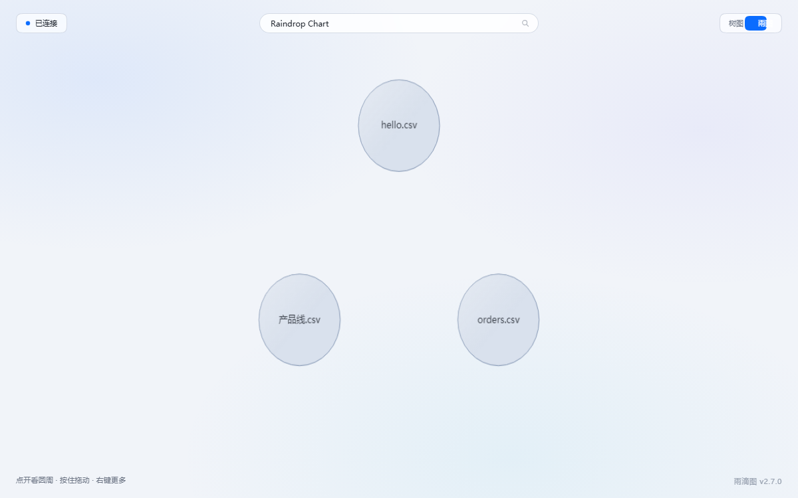
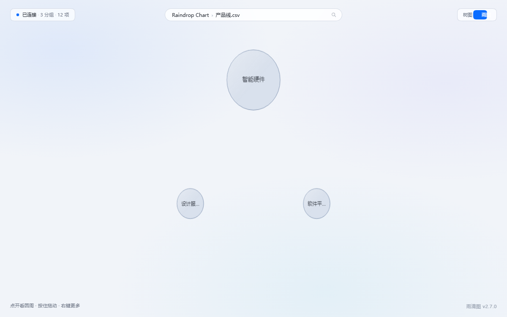
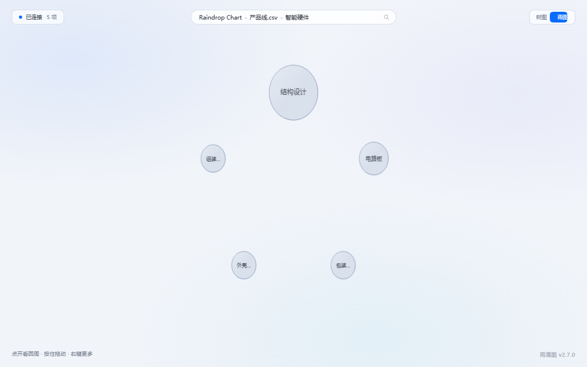

# 雨滴图 · Raindrop Chart

**把散落的文件，画成一张能点进去的图。**



---

## 你现在的处境

三个月的项目文件、四十多次对话记录、两版改到没底的方案稿——它们都在硬盘上，
但没人能一眼回答：

- 哪一块最重？
- 哪几个文件被我反复改过？
- 哪些事我其实重复做过？

雨滴图把这堆东西变成**一张图**：圆的大小就是权重，点进去是一层，再点进去是具体步骤。
不联网、不上传、不注册账号，它只在你自己的电脑上跑。

---

## 三件事

### ① 文件能画成雨滴

任何一批文件、一棵目录、一堆数据，都能变成一张能点进去的图。
大的圆代表重的东西，小的圆代表轻的；点开一层是一层，不用在文件夹里翻来翻去。



CSV 丢进去就能看；如果你用 Buddy，它的会话记录也能直接读进来。



### ② 装一个技能，Buddy 就懂你的会话

点两下，Buddy 就能直接读你这套结构。

> 「我上周在哪个项目上花的时间最多？」
> 「哪些文件被我改过三遍以上？」

这类问题不用你再复制粘贴上下文——它自己会去查。

**它只读，不改**：不会替你动文件、发消息、动账号。

### ③ 锁住不想被 AI 读的那几项

在完全开放的权限下，也能指定哪几项 Buddy 读不到。

锁的是「AI 看不见」，不是「文件被藏起来」：你照常用、照样点得开，
只是它不进入 Buddy 的视野。密码不落明文，本地只存盐和校验值。

---

## 三步就能用

### 第 1 步 · 启动

**Windows**：双击 `双击启动雨滴图.vbs`。浏览器自己打开，没有黑窗口，没有设置项。

第一次双击会在**桌面放一个 `Raindrop Chart` 图标**，以后从桌面点就行。
（网页标签页上的小图标是同一张图，服务起来就自动有了。）
不想要就删掉——**删了不会再生成**；包挪了位置，下一次双击会把图标指回新位置。

**macOS / Linux**：在这个文件夹里执行

```bash
chmod +x start.sh && ./start.sh
```

**前提只有一个**：机器上有 Python 3.8+。没有的话先装（[python.org](https://www.python.org/downloads/)，Windows 安装第一屏记得勾 `Add python.exe to PATH`）。

### 第 2 步 · 给它数据

| 你想看什么 | 怎么办 |
|---|---|
| 自己的 CSV / 文件夹 | 丢进 `data/sources/`，刷新页面 |
| 自己的会话记录 | 装过 Buddy 的话，自动就有了 |
| 先看看它长什么样 | 什么都不用做，页面自带一份示例 |

第一次打开是空的（只有示例），这是正常的。

### 第 3 步 · 想让 Buddy 也读，再点一次

双击 **`连接Buddy.vbs`** → 完全退出并重开 Buddy → 在连接器管理页点一次「信任」。

**只需要做这一次**，之后 Buddy 每次启动都会自己连上，不用再管。

> 文件名写的是 Buddy，但它会顺带识别 **Cursor / Claude Desktop**——
> 只改这台机器上**已经装了**的那几个，没装的一个都不碰。连了哪些，结果写在 `data/注册结果.txt`。

### 懒得自己点？把这句话丢给你的 AI

复制下面整段，粘给 Buddy（或任何能执行命令的 AI 助手）：

```text
把 https://github.com/Ange1314/raindrop-chart 装到本机，严格按仓库根目录的 AGENTS.md 执行：
先 clone（拉不动就下 tag zip，再不行走 ghfast.top 镜像），然后照它写的四步走完 ——
查 Python、起服务、注册 MCP、做一次真实握手验证。不许改 app/、不许动 data/、
不许上传任何东西、不许装依赖，失败就停下来告诉我，别自己编方案。
```

它会自己检查 Python、启动服务、写好连接配置、再握手验证一遍，最后提醒你重启。
`AGENTS.md` 里写死了几条硬规矩：**不许碰 `app/`、不许动 `data/`、不许上传、不许替你装任何依赖**。
它做了其中任何一件，你直接叫停。

唯一需要你动手的：**重开 Buddy，在连接器页点一次「信任」**——这一步任何 AI 都代不了。

---

## 它不做什么

- **不联网、不上传、不埋点、不需要账号**。服务只监听 `127.0.0.1`
- **不做判断**。只记录数值、次数、时间、路径——不评价好坏、不排序、不给建议
- **不替你做决定**。权重摆在那儿，决策是你或别的工具的事
- **不改你的文件**。全部只读打开

---

## 许可

[MIT](LICENSE)——随便用，商用也行，改也行，保留署名即可。

需要更多细节（数据格式、MCP 手动配置、隐私说明、已知限制、常见问题）→ [详细说明](docs/详细说明.md)
